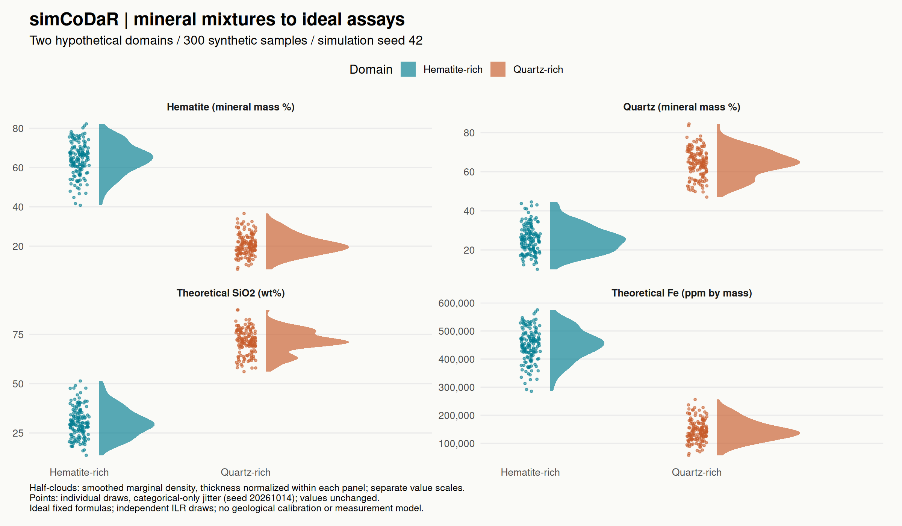
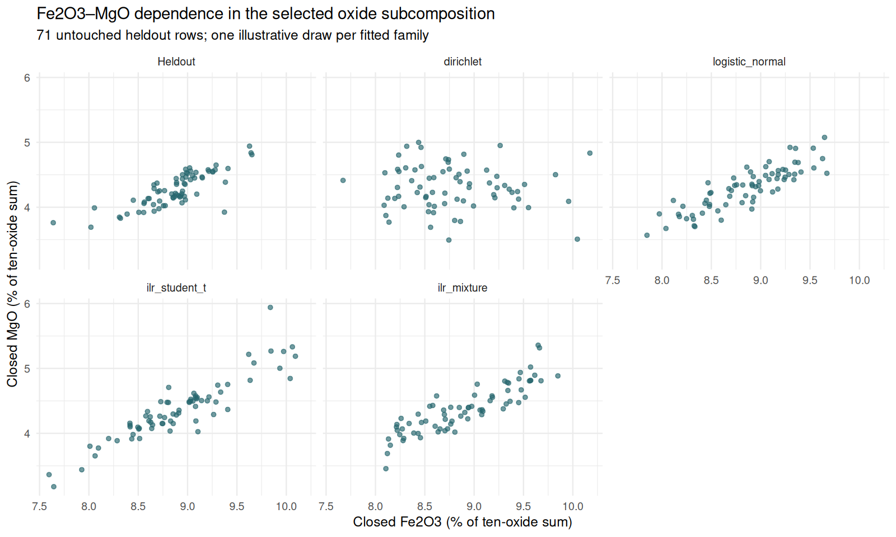

# simCoDaR

**Synthetic compositions from hypothetical targets or measured assays in R.**
Version **0.1.0.9000** provides two workflows:

- Specify hypothetical domain compositions, then draw samples and optionally
  convert ideal mineral mass fractions to theoretical assays.
- Fit the distribution of measured assay ratios, then draw synthetic selected-part
  proportions and compare them with untouched heldout assays.

Both support teaching and statistical method development. Empirical fitting learns
marginal compositional dependence; it does not establish physical mineral
calibration, geological facies, texture, recovery, spatial continuity or causality.
The original five functions remain available alongside three new empirical exports.



Every point is generated by the [standalone example](inst/examples/two-domain-assays.R).
Fixed ideal formulas link mineral mass percentages to theoretical chemistry;
the domains and their spread are user choices. Half-clouds show smoothed marginal
densities with thickness normalized within each panel, not counts or uncertainty.
Points use categorical-only jitter (seed 20261014), retaining exact values.
Each panel has its own vertical scale; these distributions do not display pairwise
correlations. [PNG](docs/assets/two-domain-assays.png) · [SVG for sharing](docs/assets/two-domain-assays.svg).

## Install from GitHub

Requires R >= 4.0.0 and internet access. From R:

```r
install.packages("remotes")
remotes::install_github("ClausonGeomet/simCoDaR", upgrade = "never")
library(simCoDaR)
```

The installer automatically installs the needed runtime dependency `withr`;
`stats` ships with R. `remotes` is an installation helper, not a runtime dependency.

## Install from a local source checkout

Requires R >= 4.0.0 and `withr`; `stats` ships with R. From R, install the one
external runtime dependency if needed:

```r
install.packages("withr")
```

From a terminal in the simCoDaR checkout:

```sh
R CMD INSTALL .
```

Then use `library(simCoDaR)` in R. This package runs independently of the original
source project. It does not require a research environment, data downloads,
`devtools`, or `testthat` for normal use. It is a development package, with no
CRAN availability claimed here.

## Workflow 1: hypothetical domain targets

These targets are hypothetical geometric centers, not fitted deposit data or
guaranteed arithmetic sample means. Each sample contains hematite, quartz and
kaolinite; its mineral fractions close to one.

```r
library(simCoDaR)

targets <- rbind(
  hematite_rich = c(Hematite = 0.65, Quartz = 0.25, Kaolinite = 0.10),
  quartz_rich = c(Hematite = 0.20, Quartz = 0.65, Kaolinite = 0.15)
)
scenario <- new_assay_scenario(
  targets, weights = c(hematite_rich = 1, quartz_rich = 1),
  logratio_sd = c(hematite_rich = 0.30, quartz_rich = 0.25)
)
x <- simulate_mineral_assay_scenario(scenario, n = 300, seed = 42)

phase <- x$observed$xrd_phase_percent       # ideal mineral mass %
oxide <- x$observed$xrf_oxide_wt_percent    # theoretical oxide wt%
element <- x$observed$icp_element_ppm      # theoretical elemental ppm by mass

table(x$domains$domain)
range(rowSums(phase))                      # 100, 100
head(oxide[c("Fe2O3", "SiO2", "Al2O3")])
head(element[c("Fe", "Si", "Al")])

features <- tibble::tibble(Hematite_mass_percent = phase$Hematite,
                       Quartz_mass_percent = phase$Quartz,
                       SiO2_wt_percent = oxide$SiO2,
                       Fe_ppm = element$Fe)
presentation <- tibble::add_column(features, sample_id = x$sample_id,
                                  domain = x$domains$domain, .before = 1)
dplyr::summarise(dplyr::group_by(presentation, domain),
  dplyr::across(dplyr::all_of(names(features)), mean), .groups = "drop")
round(cor(features), 3)
purrr::map(split(features, x$domains$domain), function(z) round(cor(z), 3))
```

For the rendered example, domain counts were 149 and 151; the maximum mineral
fraction closure error was `2.22e-16`. Rounded arithmetic sample means were:

| Domain | Hematite mass % | Quartz mass % | SiO2 wt% | Fe ppm |
| --- | ---: | ---: | ---: | ---: |
| hematite_rich | 64.332 | 25.471 | 30.217 | 449,958 |
| quartz_rich | 20.687 | 64.366 | 71.324 | 144,691 |

Pooled quartz–hematite Pearson correlation was -0.986, compared with -0.919 and
-0.857 within the two domains. Closure, domain mixing and deterministic chemistry
shape these correlations; they are descriptive, not evidence of causal or
geological relationships. Values may vary across R versions or RNG kinds.

Run the full example for summaries only, or supply a directory to regenerate
both figures using ggplot2 and ggdist. The quick start uses dplyr, purrr and
tibble for presentation; the full example and vignette also use tidyr. Install
these optional documentation dependencies from R before running the examples:

```r
install.packages(c("ggplot2", "ggdist", "dplyr", "tidyr", "purrr", "tibble"))
```

Then from a terminal:

```sh
Rscript inst/examples/two-domain-assays.R
Rscript inst/examples/two-domain-assays.R docs/assets
```

## Workflow 2: fit measured assay ratios

Use one common, nonoverlapping measurement basis. The bundled IODP example has
major oxides in dry-sediment wt%, separate trace ppm and depth in m CCSF-A.
Fit only the ten positive oxides; closing them models a selected subcomposition,
not whole-rock mass, the reported total or a manufactured remainder.

```r
library(simCoDaR)
assays <- read.csv(system.file("extdata", "iodp_u1418_major_trace.csv",
                             package = "simCoDaR", mustWork = TRUE))
parts <- c("SiO2", "TiO2", "Al2O3", "Fe2O3", "MnO", "MgO", "CaO",
           "Na2O", "K2O", "P2O5")
# A fixed disjoint depth block for this minimal example; no heldout tuning.
ordered <- order(assays$depth_m, seq_len(nrow(assays)))
heldout_rows <- sort(ordered[1:71])
train <- assays[-heldout_rows, ]
heldout <- assays[heldout_rows, ]
fit <- fit_assay_simulator(train, parts, model = "logistic_normal", seed = 42,
                          measurement_basis = "oxide_mass", unit_label = "wt%")
synthetic <- simulate_assays(fit, n = 71, seed = 123)
head(synthetic[c("Fe2O3", "MgO")])  # fractions of selected oxide sum, not wt%
attr(synthetic, "diagnostics")
evaluation <- validate_assay_simulator(fit, heldout, reference = train,
                                      n_draws = 71, replicates = 4, seed = 20261014)
evaluation$score_summary
evaluation$failures
```

Choose `dirichlet` for a positive-alpha MLE baseline, `logistic_normal` for full
ILR covariance, `ilr_student_t` for fixed predeclared df and full scale, or
`ilr_mixture` for multistart full component covariance and training-only BIC.
Student scale is not covariance. Dirichlet cannot represent positive distinct-part
population covariance. Full logratio models can learn dependence, with convergence
and regularization diagnostics that need inspection. No heldout tuning is performed.

Fit objects omit training rows and totals while retaining parameters and aggregate
counts; this is not an anonymity guarantee. Draws close to one, with counted
inverse-ILR floors that can modify extreme tails. Zeros default to refusal;
structural absence requires explicit metadata. Censoring, rounding and missing
values are not silently replaced. Sparse supports/nonconvergence fail explicitly.
Grouping is supported in fit/draw; the validator currently requires positive,
ungrouped full support and at least two heldout rows.

The [measured-assays vignette](vignettes/measured-assays.Rmd) fits all four families
on the same 213 training rows, keeping 71 contiguous depth rows untouched. It explains
common-measure scores, covariance/logratio/tail diagnostics and **conditional draw
MCSE**, with tidyverse wrangling and raincloud figures. Nearby depth rows are not
independent geological validation samples. Open a built installation with:

```r
vignette("measured-assays", package = "simCoDaR")
```



Each panel has 71 points and the same axes. These are ratios of the ten-oxide sum,
not original dry-sediment wt%. [Relationship SVG](docs/assets/measured-assays-relationship.svg)
· [Raincloud marginals PNG](docs/assets/measured-assays-marginals.png)
· [Marginals SVG](docs/assets/measured-assays-marginals.svg).
The vignette supplies the executable plotting code; density widths and jitter
represent distributions and points, not inferential uncertainty.

The installed [five-split companion](inst/examples/iodp-empirical.R) freezes
manifests/settings before 20 sequential fits and 400 small draw tables. Its `smoke`
mode is an operational example, and `freeze` writes manifests without fitting.
The vignette performs only the primary comparison with four draws per model.
Recorded reproduction found Student highest heldout log score and Dirichlet lowest
on all five splits; primary normal-better-energy was not reproduced. Differences
are metric-specific and conditional MCSEs are substantial relative to the primary
normal/Student energy difference. Historical numeric outputs/primary interval/RNG
are unavailable; these are newly declared reproduction results, never required ranks.

Read the [IODP attribution and extraction notice](inst/extdata/IODP-LICENSE-PROVENANCE.md)
and [six-source metadata catalogue](inst/extdata/SOURCE-CATALOGUE.md). The catalogue
records measurement units, material granularity, nondetects, rights and QA limits;
its small paired references are not automatically calibration populations.

## Four-commodity vignette

[From hypothetical commodity mixtures to ideal assays](vignettes/commodity-scenarios.Rmd)
teaches iron ore, trace gold, ideal NiO-bearing nickel and manganese scenarios,
with executable summaries, plots and mass-balance audits. In an installation
built with vignettes, open it with:

```r
vignette("commodity-scenarios", package = "simCoDaR")
```

GitHub installation does not build vignettes by default. To include this HTML
vignette, make Pandoc available and install the suggested R dependencies with:

```r
remotes::install_github("ClausonGeomet/simCoDaR", dependencies = TRUE, build_vignettes = TRUE)
```

`dependencies = TRUE` includes `knitr`, `rmarkdown`, `ggplot2`, `ggdist`,
`dplyr`, `tidyr`, `purrr` and `tibble`; Pandoc is also required
for the HTML build. See the [remotes installation arguments](https://remotes.r-lib.org/reference/install_github.html)
and [rmarkdown Pandoc discovery](https://rmarkdown.rstudio.com/docs/reference/pandoc_available.html).
All commodity examples use the built-in mineral library and hypothetical targets.

To include the vignette from a local checkout, make the optional dependencies
listed above, `knitr`, `rmarkdown` and Pandoc available, run `R CMD build .`, then install the resulting source tarball
with `R CMD INSTALL simCoDaR_0.1.0.9000.tar.gz`. A direct `R CMD INSTALL .`
does not build the vignette.

## Package checks

The [R-CMD-check workflow](.github/workflows/R-CMD-check.yaml) runs on pushes,
pull requests and manual dispatch using Ubuntu and release R. It runs the existing
unit tests and examples, builds and checks the executable vignette, and runs
`R CMD check --as-cran` without the PDF manual. Errors or warnings fail the check;
NOTEs remain available in the uploaded check results for review.

## Eight public functions and their roles

| Function | Purpose and main controls |
| --- | --- |
| `fit_assay_simulator()` | Fit selected amounts; ordered `parts`, family, groups/supports, fixed `student_df`, candidate `mixture_components`, basis/units and convergence controls. Returns a `geo_assay_simulator` list. |
| `simulate_assays()` | Draw from a fit; `n`, `seed`, optional fitted `group`; returns closed fraction data frame with diagnostics. Total generation is not included. |
| `validate_assay_simulator()` | Evaluate an existing positive ungrouped fit on `heldout`; optional training `reference`, draw count/repetitions/seed. Returns scores, long metrics, MC summaries, failures and metadata; never fits/tunes. |
| `new_assay_scenario()` | Named domain targets; domain `weights`; isotropic `logratio_sd`; declared `structural_parts`; fraction `composition_bounds`. |
| `simulate_assay_scenario()` | Composition-only draw; `n`, `seed`, finite `max_draw_attempts` rejection budget. |
| `mineral_assay_library()` | Named ideal formulas with explicit atom counts; inspect entries or supply a compatible library to conversion functions. |
| `minerals_to_assay()` | Convert already closed mineral rows; explicit `basis` (`fraction`/`percent`), `iron_reporting`, and input `closure_tolerance`. |
| `simulate_mineral_assay_scenario()` | Draw once and convert; `n`, `seed`, `library`, `iron_reporting`, `max_draw_attempts`; retain domain labels, truth and metadata. |

See each function's R help (`?new_assay_scenario`, for example) for input
constraints and output details. Domain weights control probabilities, not fixed
sample counts. Targets are normalized within each domain. Positive parts vary in
orthonormal log-ratio coordinates; zero spread returns the target exactly.
Declared structural zeros remain absent, with no pseudocount or detection-limit
model. Bounds reject draws; exhausted budgets stop rather than relax constraints.

## Units, truth and assumptions

`sample_id` keys the domain table and the rows in `observed` and `truth`.
`truth$mineral_fraction` retains fractions; `truth$assay` retains the full
conversion, including physical components and mass-balance audit.
`metadata` records units, supplied seed, RNG kind and scenario assumptions.
The `observed` field is an interface name for synthetic reporting tables:

- `xrd_phase_percent` is ideal phase mass %, not diffraction intensities.
- `xrf_oxide_wt_percent` contains theoretical cation oxide equivalents.
- `icp_element_ppm` contains theoretical elemental ppm by mass: 1 wt% = 10,000 ppm.

In the hypothetical workflow there is no simulated XRD/XRF/ICP instrument response, error, censoring,
missingness, spatial dependence, deposit calibration or production/process
prediction. Samples are independent conditional on their domains. Ideal mineral
formulas are fixed; solid solutions are not fitted.

Close mineral inputs in one mass unit. Do not close oxide wt% and elemental ppm
together. Water and CO2 equivalents are returned separately; nonoxide minerals
remain in the physical component audit. Reported oxide equivalents are never
renormalized: total iron as Fe2O3 can add oxygen-equivalent mass and produce totals
above 100 wt%. Inspect `truth$assay$mass_balance`, especially
`physical_components_wt_pct` and `reporting_oxygen_gain_wt_pct`.

An explicit `seed` restores the caller's RNG state, including on error; `NULL`
consumes the caller's stream. RNG kind is unchanged. Reproducibility requires the
same inputs, package/R versions and RNG kind; cross-version bitwise identity is
not promised. The API and assumptions may change during development.

## License and provenance

GPL-3. [Source provenance and modifications](inst/PROVENANCE.md) records the
selected source-relative paths, immutable commit, Research Team origin declaration
and Matt Clauson source-history attribution. [License text](inst/COPYING) is
included. The bundled IODP CSV is separately **CC BY 4.0**, attributed to
[Zindorf, März and Schnetger (2020)](https://doi.org/10.2204/iodp.proc.341.206.2020).
Its selection/renaming notice, pinned bytes and workbook limitations accompany it.
Only that approved dataset is bundled. The six-source catalogue contains metadata,
not numerical extracts. Source origin attribution and GPL-3 code licensing remain
unchanged; no source author or data-provider endorsement is implied.
